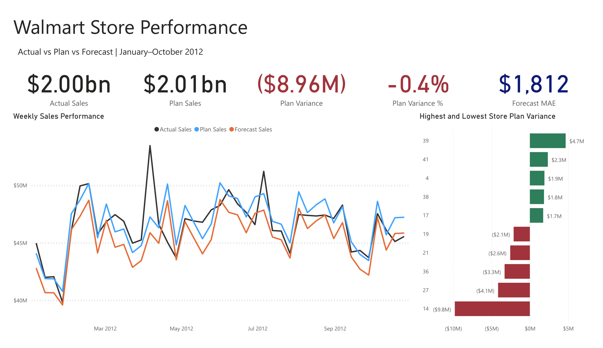
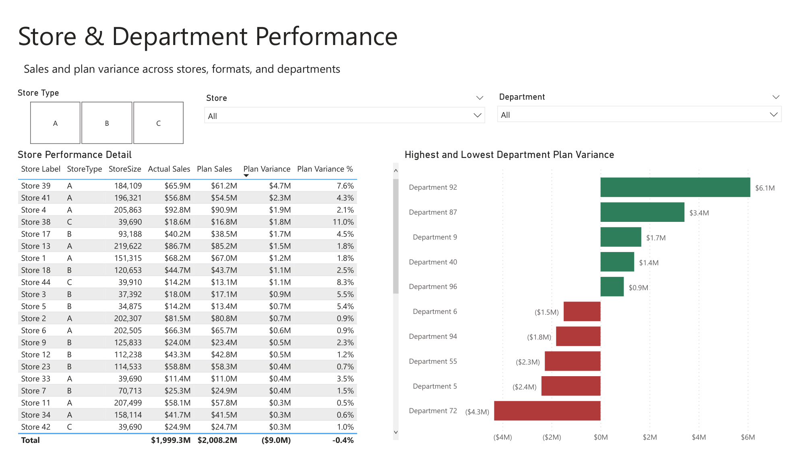
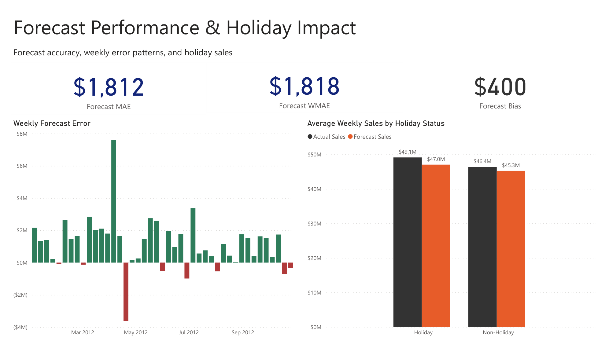
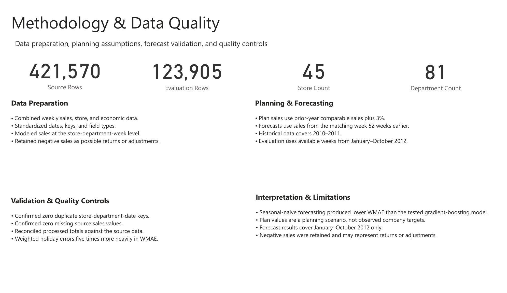
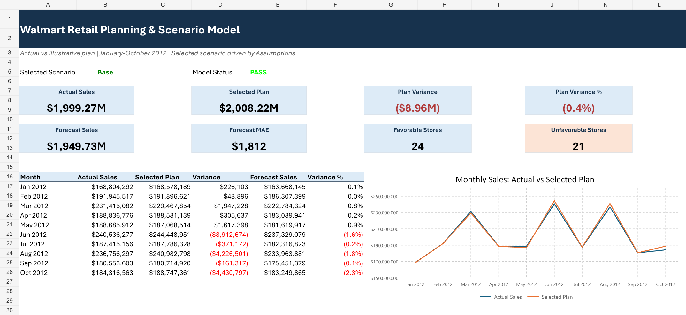
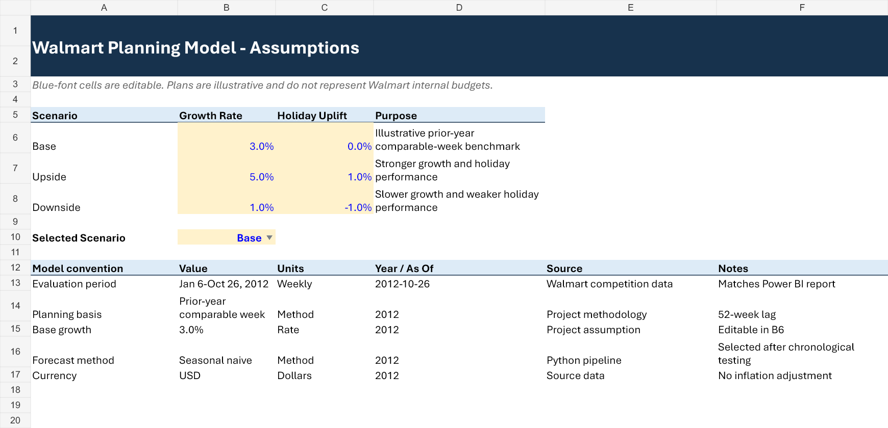
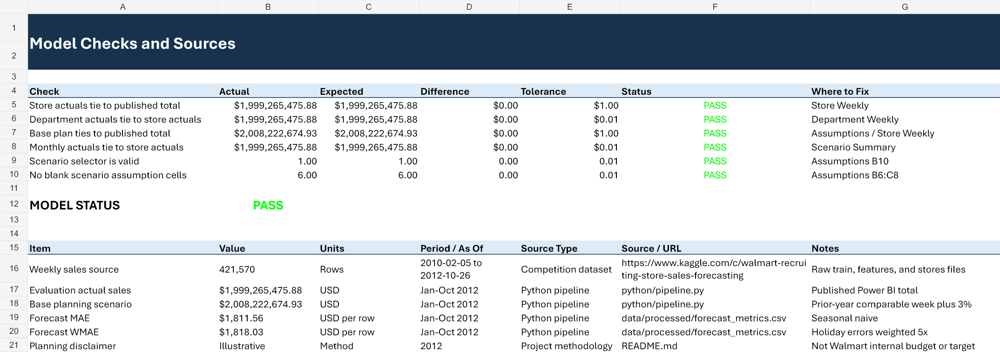

# Walmart Store Performance

End-to-end retail analytics project using Python, SQL Server, an interactive Excel planning model, and Power BI to compare actual sales with independently created scenarios and a time-aware forecast.



[View the four-page dashboard preview](documentation/Walmart_Store_Performance.pdf) | [Download the Power BI report](power-bi/Walmart_Store_Performance.pbix) | [Download the Excel planning model](excel/Walmart_Retail_Planning_Model_Final.xlsx)

> The 3% planning scenario is illustrative and does not represent Walmart's internal budget or targets.

## Business problem

Retail leaders need to know where performance is ahead of or behind plan, whether forecasts are reliable enough for operational use, and which stores and departments require attention. This project builds that reporting workflow from raw competition data through a dimensional model, reconciliation workbook, and four-page Power BI report.

## Dashboard

The report contains four pages:

1. **Executive Summary** - actual, plan, variance, forecast accuracy, weekly trends, and the highest and lowest store variances.
2. **Store & Department Performance** - interactive store and department analysis with store-type, store, and department filters.
3. **Forecast Performance & Holiday Impact** - MAE, holiday-weighted error, bias, weekly errors, and holiday versus non-holiday sales.
4. **Methodology & Data Quality** - dataset scale, preparation logic, planning assumptions, validation controls, and limitations.

| Store and department analysis | Forecast and holiday analysis |
| --- | --- |
|  |  |



## Excel planning model

The interactive workbook turns the reporting workflow into an auditable planning model. A dropdown switches between Base, Upside, and Downside scenarios, while formula-driven summaries update monthly, store, and department results. Reconciliation controls verify published totals, assumptions, scenario validity, and source completeness.



| Scenario assumptions | Model checks and sources |
| --- | --- |
|  |  |

## Key results

- Evaluated **123,905 store-department-week observations** from January through October 2012.
- Actual sales totaled **$2.00B** against a **$2.01B** planning scenario, a **-$9.0M (-0.4%)** variance.
- The seasonal-naive forecast achieved **$1,812 MAE** and **$1,818 holiday-weighted MAE**.
- Stores **39, 41, and 4** produced the largest favorable plan variances.
- Stores **14, 27, and 36** produced the largest unfavorable plan variances.
- Departments **92, 87, and 9** led plan, while departments **72, 5, and 55** trailed it most.

## Methodology

### Data preparation

The Python pipeline joins weekly sales, store attributes, and economic features; standardizes dates and keys; checks grain and completeness; and creates Power BI-ready fact and dimension files. Negative sales are retained because they can represent returns or accounting adjustments.

### Planning scenario

Plan sales are defined as the matching prior-year comparable sales value increased by 3%. The plan is a transparent analytical benchmark, not a company-provided target.

### Forecasting and evaluation

Forecast candidates are trained only on records available before each evaluated period. The selected seasonal-naive method uses sales from the matching week 52 weeks earlier and produced lower weighted error than the tested gradient-boosting model. Holiday errors receive five times the weight of ordinary-week errors, matching the competition metric.

### Data model

Power BI uses a star schema with `fact_weekly_sales` connected many-to-one to `dim_store`, `dim_department`, and `dim_date`. SQL scripts reproduce the reporting layer and validation checks, while the Excel workbook reconciles headline totals independently.

## Tools

- **Python:** pandas, scikit-learn, feature engineering, forecasting, and validation
- **SQL Server:** dimensional tables, reporting views, and reconciliation queries
- **Excel:** interactive scenario planning, variance analysis, reconciliation controls, and audit checks
- **Power BI:** data model, DAX measures, interactive analysis, and dashboard design

## Repository structure

```text
python/          Data preparation, forecasting, and SQL loading
sql/             Database objects, reporting views, and validation queries
documentation/   Requirements, metric definitions, findings, and PDF preview
power-bi/        Final Power BI report
images/          Exported dashboard pages
excel/           Final interactive planning and scenario workbook
data/raw/        Source-file instructions
data/processed/  Locally generated analytical outputs
```

## Reproduce the analysis

1. Download the Walmart Recruiting Store Sales Forecasting files and place `train.csv.zip`, `features.csv.zip`, and `stores.csv` in `data/raw/`.
2. Install dependencies with `python -m pip install -r requirements.txt`.
3. Run `python python/pipeline.py`.
4. Run the SQL scripts in numerical order if using SQL Server.
5. Open `excel/Walmart_Retail_Planning_Model_Final.xlsx` to test the Base, Upside, and Downside scenarios.
6. Open `power-bi/Walmart_Store_Performance.pbix` or rebuild from the generated CSV files.

The large generated fact and evaluation files are intentionally excluded from Git. They are recreated deterministically by the pipeline.
